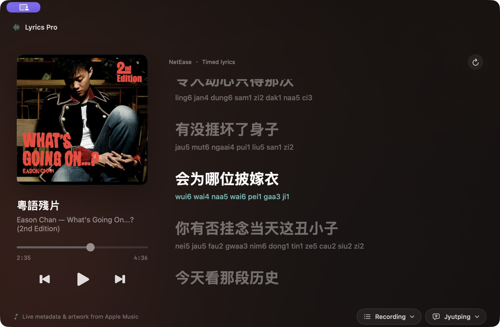

# Lyrics Pro

Sing along with Apple Music using synchronized lyrics and local Cantonese Jyutping
or Taiwanese Hokkien Tâi-lô pronunciation.

**[Download for macOS](https://github.com/inhzus/lyrics-pro/releases/latest)** ·
Apple Silicon (M1 or newer) · macOS 15+



## Features

- Lyrics that highlight and scroll with the music, alongside album artwork.
- Local pronunciation with no AI service, account, or API key.
- Play/pause, previous/next, timeline seeking, and click-to-seek lyric lines.
- Alternative recording selection and offline access to previously cached lyrics.

## Install

1. Download the ZIP from [GitHub Releases](https://github.com/inhzus/lyrics-pro/releases/latest).
2. Unzip it and drag **Lyrics Pro.app** into **Applications**.
3. Open Lyrics Pro, play a song in Apple Music, and allow Music Automation access.

Python, Homebrew, and developer tools are **not needed** for the download.

The app is not notarized. If macOS blocks a trusted copy, attempt to open it,
then use **System Settings → Privacy & Security → Open Anyway**, if offered.
If Music permission was denied, enable it under **Privacy & Security → Automation**
and choose **Lyrics Pro → Reconnect to Music**.
See [installation details](packaging/Install.txt) for more help.

## Use

- **Pronunciation:** choose Cantonese, Hokkien, or original lyrics using the
  bottom-right menu. Auto guesses from the artist; choose manually if it is wrong.
- **Wrong recording:** open **Recording** beside the pronunciation menu and choose
  an alternative. Your choice is remembered for that song.
- **Follow the music:** click a timed lyric to seek. Scrolling lets you browse;
  **Resume following** returns to the current line.
- **Missing lyrics:** try the circular retry button. For connection problems,
  reconnect to Music; diagnostics are under **Help → Open Logs Folder**.

Lyrics come from NetEase Cloud Music, with LrcAPI and LRCLIB fallbacks. Coverage
and timing vary by recording. An internet connection is needed for uncached lyrics.
Pronunciation is dictionary-based guidance; Hokkien uses southern Taiwanese Tâi-lô.
The app sends song metadata to lyric providers, not audio.

## Build from source

On an Apple Silicon Mac with macOS 15+, install Apple's Command Line Tools
(Swift 6 or newer), [uv](https://docs.astral.sh/uv/), and fish. From a checkout:

```fish
fish scripts/build-macos.fish
open "dist/Lyrics Pro.app"
```

The build creates a portable app and ZIP in `dist/`.
Development, testing, and packaging guidance is in [AGENTS.md](AGENTS.md).

## Terminal client

With macOS, Apple Music, and `uv`, run from a checkout:

```fish
uv sync --locked
uv run lyrics-pro --language cantonese
```

Use `--language hokkien` for Taiwanese Hokkien, or omit the flag for Auto.
The terminal client follows playback and prints lyrics; control playback in Music.
Press Ctrl-C to exit.

## License and acknowledgements

[MIT License](LICENSE) · Copyright 2026 inhzus.
Pronunciation uses [ToJyutping](https://github.com/CanCLID/ToJyutping) and
[Taibun](https://github.com/andreihar/taibun). Third-party license notices are
included in the app.
