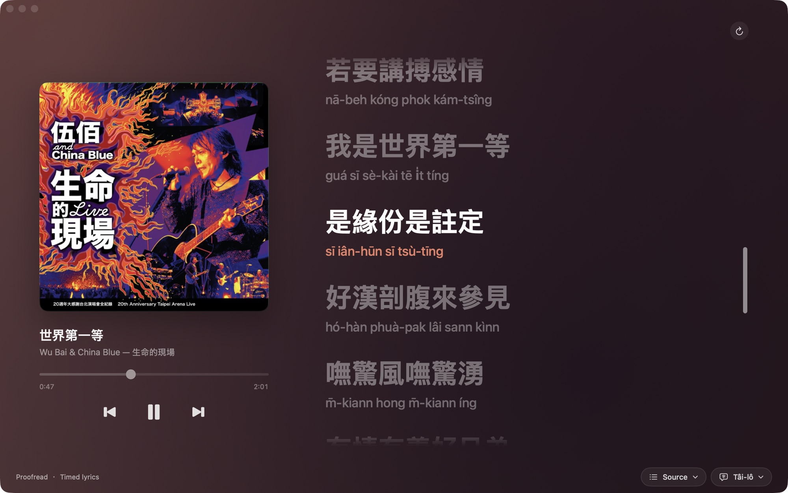

# Lyrics Pro

Sing along with Apple Music using synchronized lyrics and local Cantonese Jyutping
or Taiwanese Hokkien Tâi-lô pronunciation.

**[Download for macOS](https://github.com/inhzus/lyrics-pro/releases/latest)** ·
Apple Silicon (M1 or newer) · macOS 15+ ·
**[Read lyrics online](https://lyrics.inhzus.io)** (Taiwanese songs with Tâi-lô, no app needed)



## Features

- Lyrics that highlight and scroll with the music, colored by the album cover.
- Album artwork from Music, or the Apple catalog when Music has none.
- Local, dictionary-based pronunciation: no AI service, account, or API key.
- Play/pause, previous/next, timeline seeking, and click-to-seek lyric lines.
- Alternative recordings, offline cached lyrics, and 66 bundled proofread songs.

## Install

1. Download the ZIP from [Releases](https://github.com/inhzus/lyrics-pro/releases/latest),
   unzip it, and drag **Lyrics Pro.app** into **Applications**. No Python,
   Homebrew, or developer tools are needed.
2. Open Lyrics Pro, play a song in Apple Music, and allow Music Automation access.

The app is not notarized. If macOS blocks it, try opening it, then choose
**System Settings → Privacy & Security → Open Anyway**. If Music access was denied,
enable it under **Privacy & Security → Automation** and choose
**Lyrics Pro → Reconnect to Music**. See [installation details](packaging/Install.txt).

## Use

- **Pronunciation** (bottom right): set a language for **This Song** or the
  **Global Default** (initially Cantonese). **Use Default** prefers proofread
  spelling when available; **Original** hides spelling for a song. Song choices
  carry across albums.
- **Source** (beside it): pick a different recording if lyrics don't match.
  **Proofread** lyrics (offline, with supplied spelling, marked in the footer) are
  preferred by **Automatic** when the title and duration match; an online recording
  uses that provider's lyrics. Your choice is remembered for the song.
- **Follow the music:** click a timed line to seek; scroll to browse, then
  **Resume following**.
- **Settings (⌘,):** Chinese as provided, Simplified, or Traditional; text size
  (also **View → Bigger/Smaller**, ⌘= / ⌘−); timing offset for drifting lyrics; keep
  on top; and clearing cached or saved data.
- **Missing lyrics:** use the retry button at the top right, or reconnect to Music.
  Logs are under **Help → Open Logs Folder**.

Lyrics come from NetEase Cloud Music, with LrcAPI and LRCLIB fallbacks; coverage and
timing vary by recording, and uncached lyrics need an internet connection. Only song
metadata is sent, never audio. Hokkien uses southern Taiwanese Tâi-lô.

## Build from source

On an Apple Silicon Mac with macOS 15+, install Apple's Command Line Tools
(Swift 6 or newer), [uv](https://docs.astral.sh/uv/), and fish, then:

```fish
fish scripts/build-macos.fish   # portable app and ZIP in dist/
open "dist/Lyrics Pro.app"
```

Development, testing, and packaging guidance is in [AGENTS.md](AGENTS.md).

## Terminal client

From a checkout, with Apple Music and `uv`:

```fish
uv sync --locked
uv run lyrics-pro --language cantonese   # or hokkien; default cantonese
```

It follows playback and prints lyrics (control playback in Music; Ctrl-C exits) and
does not use the app's saved song preferences.

## License and acknowledgements

[MIT License](LICENSE) · Copyright 2026 inhzus. Pronunciation uses
[ToJyutping](https://github.com/CanCLID/ToJyutping) and
[Taibun](https://github.com/andreihar/taibun); third-party notices are included in
the app. Transcriptions keep their [supplied credits](packaging/Proofread-content.txt)
and the website links each page to its source; song text and transcription are not
covered by the MIT license.
